<div align="center">


# Shipment

**The back office of a delivery operator, working like Glovo.**
Partners hand orders over at pickup points, the store picks and packs them (missing stock is refunded, never charged),
a courier on a bike, in a car or in a van takes them to the door along a real OpenStreetMap route, and an append-only
ledger settles the charge, the commission, the payout and the tip.


<br />


<sub>Live tracking of the seeded Kraków demo: routes from OSRM, the path driven, the courier's position, ETA and
on time / late - real screens, all of them in <a href="docs/screens/"><code>docs/screens/</code></a>.</sub>

</div>

---

## Why it is interesting

- **DDD bounded contexts without microservices.** Nine contexts (`crm`, `catalog`, `carriers`, `compliance`,
  `ordering`, `dispatch`, `tracking`, `billing`, `notifications`) are modules of one process and one database, each
  with its own schema, domain and application service, after CodeOpinion's DDD examples (ADR 0008).
- **Dependencies point one way.** A context reads only itself and the contexts below it. When a lower one must react
  to a higher one, the change goes through an **integration event**: an outbox row written in the same `SaveChanges`,
  then a Wolverine runner on RabbitMQ (ADR 0007).
- **Rules live in the domain.** Every write goes domain entity → application service → one `SaveChanges`. A refusal is
  a `Result`/`Error` that maps to 400 / 404 / 409. The Blazor pages and the `/api/v1` Minimal API call the same
  services (ADR 0002, 0013).
- **Money you can audit.** `billing.entries` is append-only: a trigger refuses UPDATE and DELETE, and partial unique
  indexes allow one entry of a kind per order. Handlers are idempotent per event id, so a redelivered message never
  books twice.
- **Real-world edge cases.** Stock that runs out at picking (partial fulfilment with a refund per line), 18+ products
  that need an ID check at handover, a vehicle that must fit the order's size and weight, courier documents that expire.
- **A real map.** Leaflet and OpenStreetMap, routes from OSRM per vehicle profile, fetched by the runner and stored as
  GeoJSON. No PostGIS: distances are haversine in SQL.
- **Correct under concurrency.** PostgreSQL `xmin` is the row version. A stale write, or a race EF catches at save, is
  a 409, never a lost update.
- **Least-privilege database.** The migrator, the host and the runner each have their own role, defined in an EF
  migration, and no credential is in the repository (ADR 0011).

## Screenshots

| | |
|---|---|
| 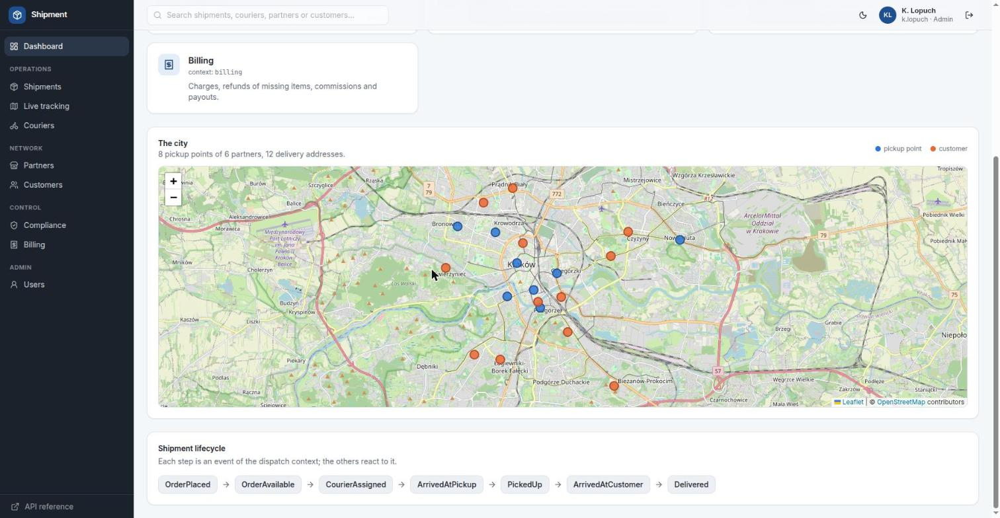 | 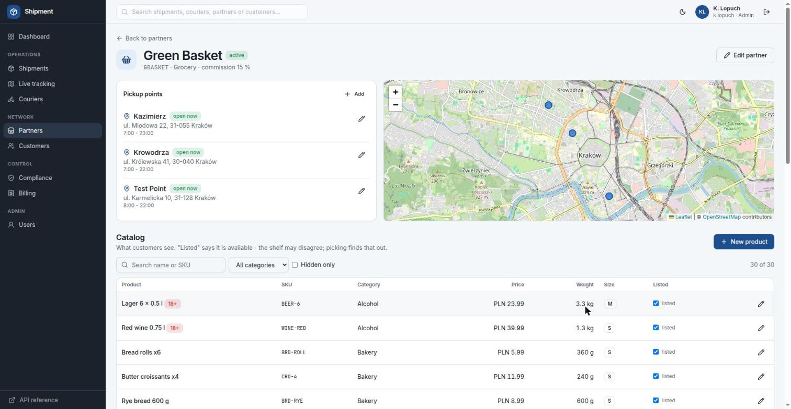 |
| **Dashboard**: the city at a glance, with pickup points, customers and couriers on the map. | **Partner**: pickup points with opening hours, the catalog with sizes, weights and 18+ flags. |
| 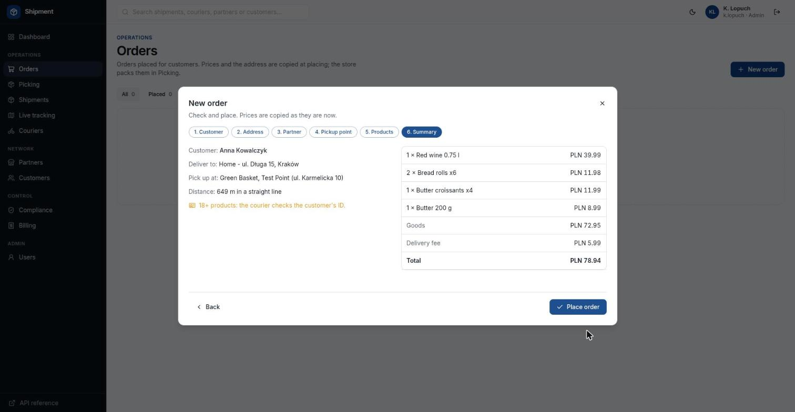 |  |
| **New order**: a six-step wizard. Prices and the address are copied, and the fee is set by distance bands. | **Picking**: on a tablet-sized screen, each line is packed or missing. A missing line is never charged. |
|  | 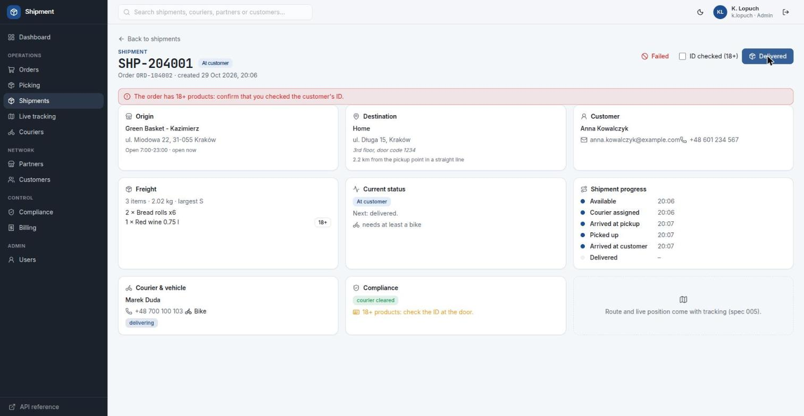 |
| **Dispatch**: proposals of couriers who are available, cleared, have a vehicle big enough, sorted nearest first. | **Handover**: an 18+ order needs the ID check. A refusal fails the shipment and refunds the order. |
| 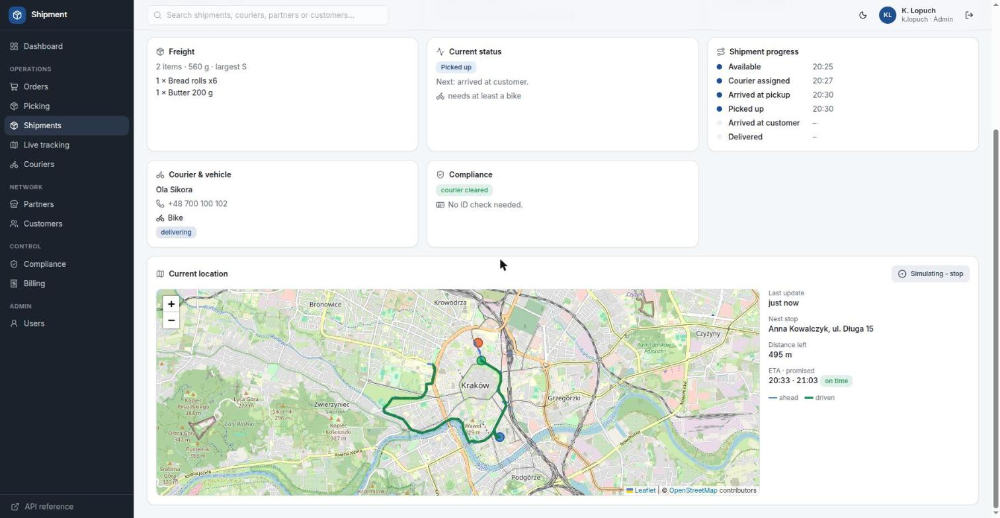 |  |
| **Tracking**: both legs of the route, the path driven, distance left and ETA. | **Billing**: the day's charges, refunds, commissions, payouts and tips, per partner and per courier. |
| 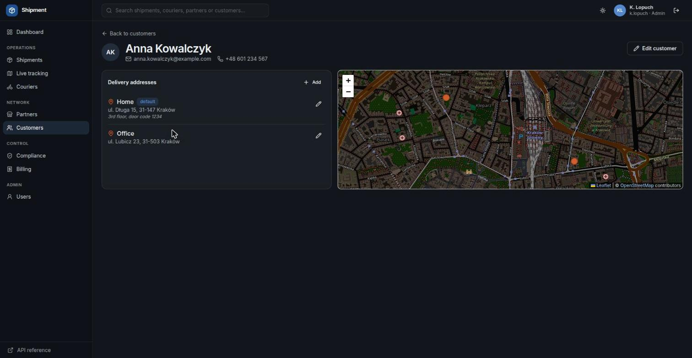 | 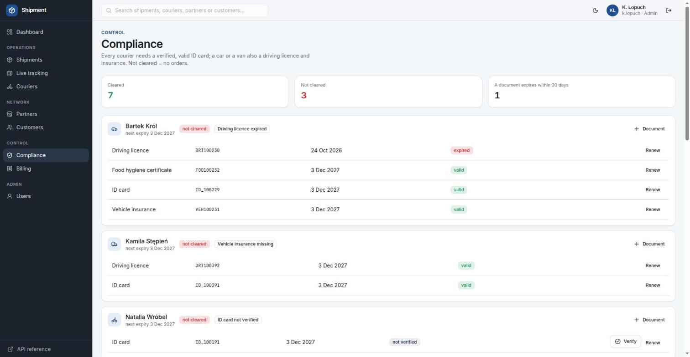 |
| **Dark theme**: Ambit's design tokens on Tailwind CSS v4, with the map tiles inverted by CSS (ADR 0005). | **Compliance**: courier documents with verification and expiry, and clearance with its reasons. |

## Architecture

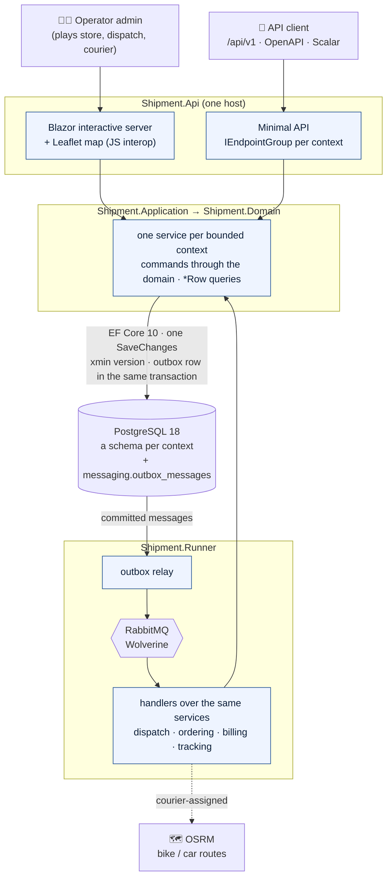

The Blazor pages inject the services and make no HTTP calls to their own host. The REST API is a thin adapter over the
same calls, so a rule is written once.

### Bounded contexts and who reads whom

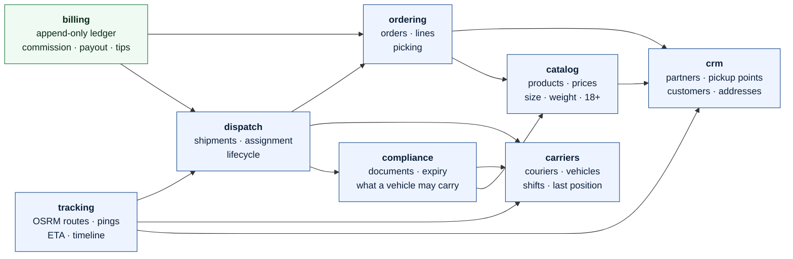

An arrow means "reads the data of". The way back, from a higher context to a lower one, goes only through
integration events.

### An order, from the basket to the doorstep

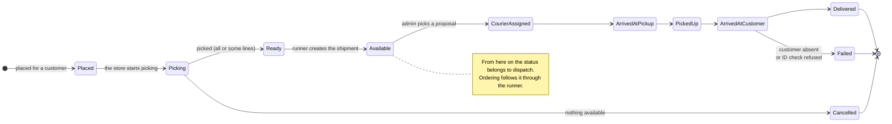

### Missing stock: picking, the outbox and the refund

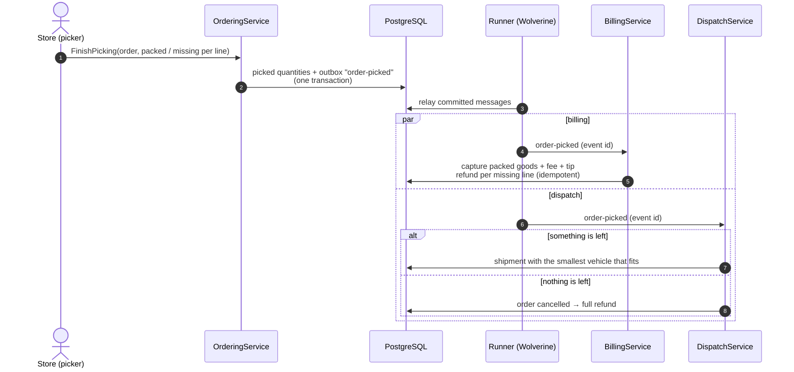

### Who gets what: the ledger

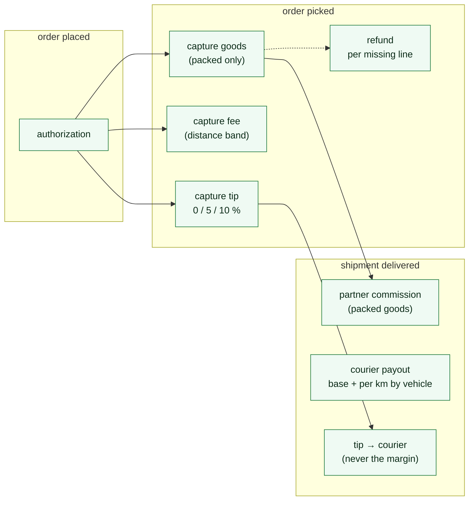

A cancelled or failed order gets a full refund. Every entry is booked once per event id and is never updated.

## Stack

| Area | Choice |
|---|---|
| Host & UI | .NET 10, ASP.NET Core, Blazor interactive server, Tailwind CSS v4 on Ambit's tokens (output committed), Lucide icons, light/dark |
| API | Minimal API `/api/v1`, `IEndpointGroup` per context, OpenAPI `/openapi/v1.json`, Scalar, ProblemDetails |
| Data | EF Core 10 + Npgsql, PostgreSQL 18, a schema per context, snake_case, enums as strings, `xmin` concurrency, CHECK constraints, roles in a migration |
| Messaging | Transactional outbox → `Shipment.Runner` on Wolverine + RabbitMQ, idempotent handlers |
| Map | Leaflet 1.9.4 (vendored) + OpenStreetMap tiles, OSRM routes, haversine distances, GeoJSON in `jsonb` |
| Observability | Serilog, OpenTelemetry (ASP.NET Core, HTTP, Npgsql), `/health` |
| Quality | xUnit v3 + Testcontainers on PostgreSQL 18 (schema from the migrations), CSharpier, JetBrains InspectCode (0 findings), Husky.Net, `TreatWarningsAsErrors` |

## Repository

```text
apps/Shipment.Api/          the host: Blazor (Components/), REST API (Endpoints/), /auth, OpenAPI + Scalar, health
apps/Shipment.Runner/       outbox relay, Wolverine on RabbitMQ, handlers over the application services
apps/Shipment.DbMigrator/   database, roles, EF Core migrations, Kraków demo seed
libs/Shipment.Domain/       entities and rules per bounded context, Result/Error
libs/Shipment.Persistence/  ShipmentDbContext, configurations, Migrations/ (the only source of the schema)
libs/Shipment.Application/  one service per bounded context: commands and *Row queries
libs/                       Geo, Messaging.Contracts, Observability, Emails
tests/Shipment.Tests/       service and HTTP tests on a real database (./verify <group>)
```

## Documentation

| Document | What is in it |
|---|---|
| [`PRODUCT.md`](PRODUCT.md) | goals with "Done when", non-goals, decisions, state |
| [`docs/domain.md`](docs/domain.md) | bounded contexts, lifecycle, missing stock, integration events, courier choice, map |
| [`docs/design.md`](docs/design.md) | repository, request flow, database roles, schema, refusals |
| [`docs/adr/`](docs/adr/) | decisions 0002-0013 (0013: EF Core and application services) |
| [`CLAUDE.md`](CLAUDE.md) | commands and rules for working in the repository |

## Run locally

Needs the .NET SDK 10, Docker and the shared Swarm stack `hr-local` (PostgreSQL, RabbitMQ and MailPit on the network
`lnet`, a gateway on 127.0.0.1). For local use only: no production in 2026 (ADR 0003).

```bash
cp .env.sample .env              # SHIPMENT_PASSWORD - the password of every account
./deploy/deploy.sh               # database, roles, vhost, images; http://127.0.0.1:5400 and shipment-runner
./deploy/deploy.sh --db-only     # database and migrations only (with dotnet run)
./deploy/remove.sh               # stop the containers (--purge: database, roles, vhost too)
dotnet run --project apps/Shipment.Api
dotnet run --project apps/Shipment.Runner
```

Sign in as `k.lopuch` with the password from `.env`, or use "Sign in as the default admin" (demo only). The seed is
Kraków: 6 partners, 8 pickup points, 98 products, 12 customers, 10 couriers with documents.

## Tests

```bash
./verify <schema|platform|crm|catalog|carriers|compliance|ordering|dispatch|tracking|billing|web>
                                 # one group; needs Docker (PostgreSQL 18 in a container, schema from the migrations)
dotnet csharpier check .
./scripts/inspect-code.sh        # JetBrains InspectCode, 0 findings
```

Each context is tested on the real database for success, every validation, 409 (stale version) and 404.

## Migrations

```bash
dotnet ef migrations add <Name> --project libs/Shipment.Persistence --output-dir Migrations
./deploy/deploy.sh --db-only
```

## Status

Specs 001-006 are done: partners, the catalog, the map, couriers, compliance, orders and picking, dispatch, tracking,
billing and tips. Next is **007, e-mails** to customers (MailPit) for the `notifications` context.

## License

MIT - see [LICENSE](LICENSE).
