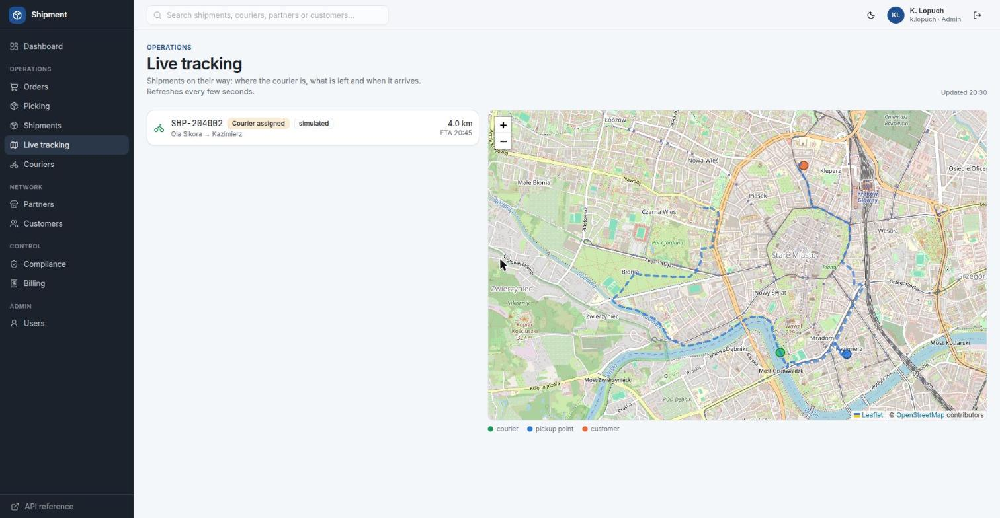
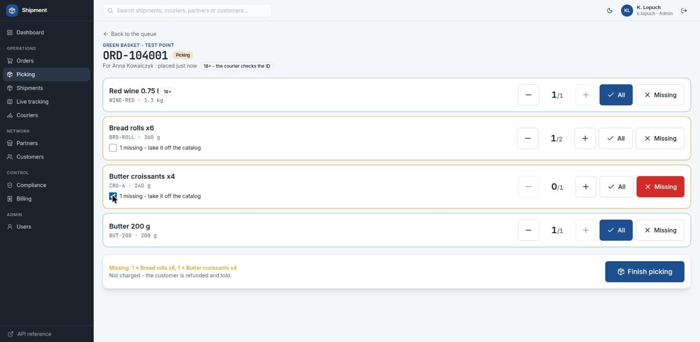
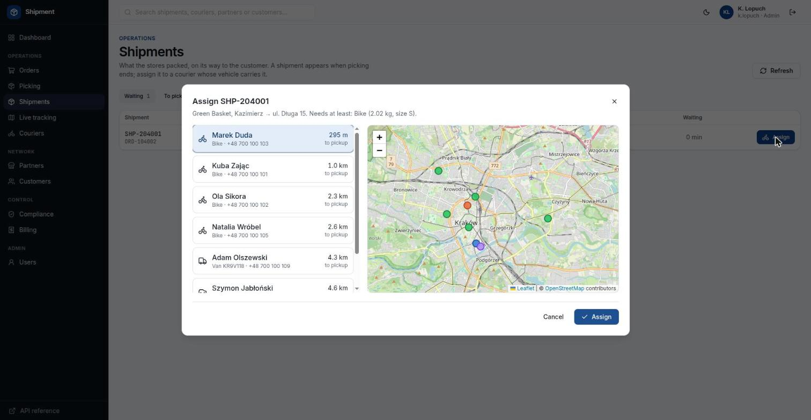
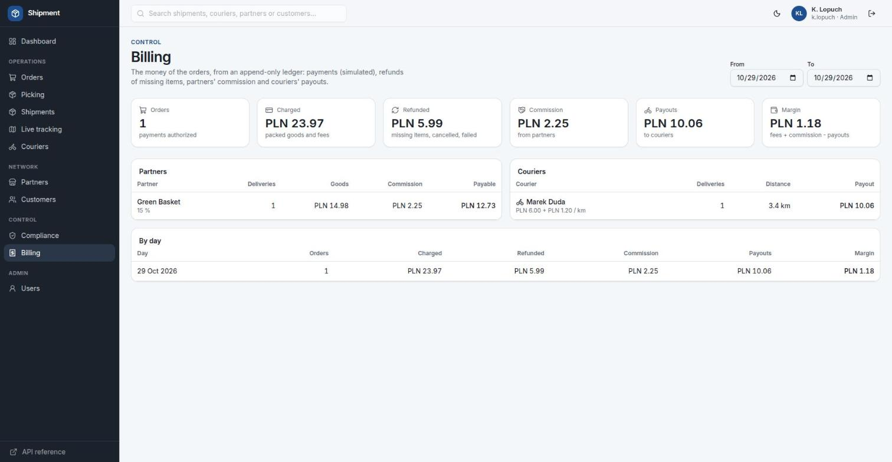

# Shipment

**A delivery operator's back office (Glovo-style)**: a .NET 10 **modular monolith** with DDD bounded contexts,
**EF Core on PostgreSQL**, an **outbox + Wolverine runner**, and the **Blazor UI and REST API in one host**.

An order goes from the basket to the doorstep and is settled. Partners hand orders over at pickup points, the store
picks and packs them (missing stock is refunded, never charged), a courier on a bike, in a car or in a van takes them to
the customer along a route on an OpenStreetMap map, and billing records the charge, commission and payout.



## Highlights

- **Modular monolith, not services**: the bounded contexts (`crm`, `catalog`, `carriers`, `compliance`, `ordering`,
  `dispatch`, `tracking`, `billing`, `notifications`) are modules of one process and one database, each with its own
  schema and application service, following CodeOpinion's DDD examples (ADR 0008).
- **Rules in C#**: every write goes through a domain entity and an application service, with one `SaveChanges` per
  command; refusals as `Result`/`Error` mapped to 400 / 404 / 409 (ADR 0013).
- **Outbox and runner**: reactions between contexts are integration events written to `messaging.outbox_messages` in
  the same transaction and handled by `Shipment.Runner` on Wolverine and RabbitMQ (ADR 0007).
- **One host**: Blazor pages inject the same services that the `/api/v1` Minimal API calls, with OpenAPI and Scalar
  (ADR 0002).
- **Schema from the EF Core migrations**: snake_case, `xmin` as the row version (stale writes give 409), and database
  roles and grants defined in a migration.
- **Tested on real PostgreSQL**: xUnit v3 and Testcontainers run against PostgreSQL 18, with the schema built from the
  migrations. Browser screenshots for every module are in [`docs/screens/`](docs/screens/).
- **Ambit's look**: Tailwind CSS v4 on Ambit's design tokens, with light and dark themes (ADR 0005).

For local use only; not in production in 2026 (ADR 0003).

| Order picking with missing lines | Assigning a courier | Billing |
|---|---|---|
|  |  |  |

## Documentation

| Document | What is in it |
|---|---|
| [`PRODUCT.md`](PRODUCT.md) | goals with "Done when", non-goals, decisions, state (mirrors the SDD project in the DC wiki) |
| [`docs/domain.md`](docs/domain.md) | bounded contexts, lifecycle, missing stock, integration events, map |
| [`docs/design.md`](docs/design.md) | repository, request flow, roles, schema, refusals |
| [`docs/adr/`](docs/adr/) | decisions 0002-0013 (0013: EF Core and application services) |
| [`CLAUDE.md`](CLAUDE.md) | commands and rules for working in the repository |

## Architecture

```text
browser ─► Shipment.Api (one host, ADR 0002)
             ├─ Blazor interactive server ─► application services (in process)
             ├─ /api/v1/…  Minimal API ─► the same services          (OpenAPI /openapi/v1.json, Scalar /scalar/)
             └─ /auth, /health
Shipment.Application ─► Shipment.Domain (rules) + Shipment.Persistence (EF Core, migrations) ─► PostgreSQL 18
     │ messaging.outbox_messages (integration events, same SaveChanges)
     ▼
Shipment.Runner ─► Wolverine on RabbitMQ ─► handlers over the services: dispatch, ordering, billing, OSRM routes
```

## Stack

.NET 10, ASP.NET Core Minimal API, Blazor interactive server, Scalar · EF Core 10 + Npgsql on PostgreSQL 18 ·
RabbitMQ + Wolverine · Serilog + OpenTelemetry · Tailwind CSS v4 (CLI, output committed), Lucide · xUnit v3 +
Testcontainers.

## Run locally

Needs .NET SDK 10, Docker and the shared Swarm stack `hr-local` (PostgreSQL, RabbitMQ, MailPit on network `lnet`,
gateway on 127.0.0.1).

```bash
cp .env.sample .env              # SHIPMENT_PASSWORD - the password of every account
./deploy/deploy.sh               # database, roles, vhost, images; http://127.0.0.1:5400 and shipment-runner
./deploy/deploy.sh --db-only     # database and migrations only (with dotnet run)
./deploy/remove.sh               # stop the containers (--purge: database, roles, vhost too)
dotnet run --project apps/Shipment.Api
```

Sign in as `k.lopuch` with the password from `.env`.

## Tests

```bash
./verify <schema|platform|crm|catalog|carriers|compliance|ordering|dispatch|tracking|billing|web>
                                 # one group; needs Docker (PostgreSQL 18 in a container, schema from the migrations)
dotnet csharpier check .

# a schema change
dotnet ef migrations add <Name> --project libs/Shipment.Persistence --output-dir Migrations
```
