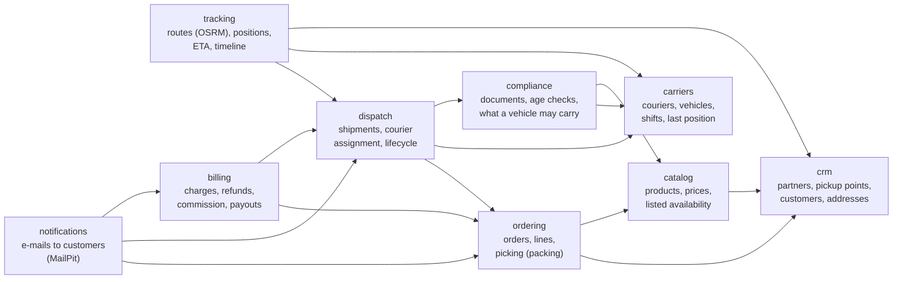
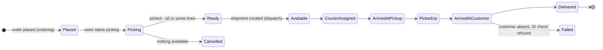

# Domain

Shipment models one delivery operator in one city (Kraków in the seed), working like Glovo: customers order from
**partners** (grocery stores, restaurants, pharmacies, shops), the partner's staff **pick and pack** the order at a
**pickup point**, a **courier** on a bike, in a car or in a van takes it to the **customer**, and money is settled
between all of them. Everyone using the app is an admin of the operator (ADR 0006): the admin acts for the store
(picking), for dispatch and, in the demo, for the courier (or a simulator moves the courier).

The design follows CodeOpinion: the shipment sits in the middle of bounded contexts, each owning its data; ids come
from the client (ADR 0009); the detail page composes the contexts' views (ADR 0010). Unlike the videos, the contexts
are **modules of one database** in one host, not services (ADR 0008).

An arrow means "reads the data of". A lower module never reads a higher one; when it must react to one, the higher
module enqueues an **integration event** (ADR 0007) and the runner calls the lower module's application service.

## Modules (dependency order)

| nn | Module | Owns | Pages |
|---|---|---|---|
| 00 | `platform` | people of the operator (identity), actor helpers | Users |
| 10 | `crm` | partners, pickup points (address, lat/lon, opening hours), customers and their delivery addresses | Partners, Customers |
| 15 | `catalog` | products of a partner: name, price, weight, size class, age-restricted flag, **listed** as available | partner's catalog |
| 20 | `carriers` | couriers, vehicle type (`bike`, `car`, `van`) and capacity, shift status (`offline`, `available`, `busy`), last known position | Couriers |
| 25 | `compliance` | courier documents (ID, driving licence for car/van, insurance) with expiry; rules: age-restricted products need an ID check at handover, which vehicle may carry which size/weight | Compliance |
| 30 | `ordering` | orders and lines (prices copied at order time), **picking** (packing order for the store): per line picked or missing | Orders, Picking |
| 40 | `dispatch` | the shipment: pickup point → drop-off, required vehicle, courier assignment, lifecycle | Shipments, shipment detail |
| 50 | `tracking` | the route of a shipment (geometry, distance, duration from OSRM), position pings, ETA, timeline | Live tracking, map cards |
| 60 | `billing` | customer charge and refunds, delivery fee, partner commission, courier payout | Billing |
| 70 | `notifications` | e-mails sent (one per event and recipient - idempotency) | e-mail log |

Common to every module (ADR 0013): tables in the schema `<module>`, the rules in `Shipment.Domain.<Module>`, the use
cases in `Shipment.Application.<Module>`; `xmin` as the row version (stale → 409); a missing row → 404; amounts in minor units (`bigint`, grosze) with a currency `PLN`; coordinates as `numeric(9,6)`; times `timestamptz`.

## Lifecycle

Order statuses belong to `ordering`; from `Available` on, the statuses belong to the shipment in `dispatch`
(CodeOpinion's OrderAvailable → CarrierAssigned → OrderDispatched → ArrivedShipper).

## Out of stock: partial fulfilment

The catalog **lists** a product as available, but the store may not have it on the shelf. That is found out only at
picking: the picker marks a line (or part of its quantity) as **missing**. When picking ends:

1. `ordering` sets the picked quantities and enqueues `order-picked` with the missing lines.
2. `billing` (runner → `BillingService`) charges only what was picked and records a **refund** for the missing
   lines (the payment itself is simulated - no payment provider).
3. `notifications` e-mails the customer (MailPit): what will be delivered, what was missing, the refund amount.
4. `dispatch` creates the shipment for what is left; nothing left = the order is cancelled and fully refunded.

## Integration events

| Event | Raised by | Reacts |
|---|---|---|
| `order-placed` | ordering | notifications (confirmation e-mail) |
| `order-picked` (picked and missing lines) | ordering | billing (charge, refund), dispatch (create shipment or nothing), notifications (partial fulfilment e-mail) |
| `order-cancelled` | ordering | billing (full refund), notifications |
| `courier-assigned` | dispatch | tracking (route from the courier to the pickup point and on to the customer - OSRM through the runner) |
| `shipment-status-changed` | dispatch | tracking (timeline), ordering (order delivered / failed) |
| `shipment-delivered` | dispatch | billing (commission, payout), notifications (delivered e-mail) |

Each handler is idempotent: the event id is stored by the module that reacted.

## Courier choice

Dispatch proposes couriers who are `available`, whose vehicle fits the order (size class and weight from the
catalog; `bike` small, `car` medium, `van` large - limits in `carriers`), whose documents are valid
(`compliance`), sorted by straight-line distance (haversine in SQL) from their last position to the pickup point.
The admin assigns one; automatic assignment is "not yet".

## Map

Leaflet with OpenStreetMap tiles in a Blazor component (JS interop); routes from OSRM by vehicle profile
(bike → cycling, car/van → driving), fetched by the runner and stored in `tracking` - pages never call OSRM. No
PostGIS (the shared PostgreSQL image has none): coordinates as numbers, routes as GeoJSON in `jsonb`.
